# Macrobond for ChatGPT and Codex

Search and retrieve economic time series data from Macrobond in ChatGPT and
Codex.

## Requirements

- An active Macrobond AI Data Feed subscription or Macrobond Assist license, and a Macrobond account
- Access to plugins in ChatGPT or Codex

## Install

Choose the install method for where you use ChatGPT:

| Method | Works in |
|---|---|
| [MCP connector](#mcp-connector) | ChatGPT on the web (**Chat** and **Work**) and the ChatGPT desktop app (**Chat**, **Work** and **Codex**) |
| [Marketplace](#marketplace) | ChatGPT desktop app (**Work** and **Codex**) |

The MCP connector adds the hosted Macrobond MCP service to your ChatGPT account,
so it works everywhere. The marketplace plugin adds the Macrobond skill and
configures the same service, but the ChatGPT desktop app runs that
configuration only in **Work** and **Codex**.

In a ChatGPT Business workspace, an admin can set up Macrobond for all members.
See [ChatGPT workspace](#chatgpt-workspace).

### MCP connector

1. On [chatgpt.com](https://chatgpt.com), open **Plugins** in the sidebar.
   Select **Add**, then **Add custom MCP server**.

   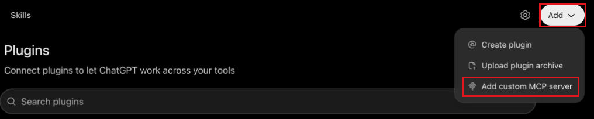

2. Enter **Macrobond** as the name and `https://platform.macrobond.com/mcp` as
   the server URL. Keep **Authentication** set to **OAuth**.
3. Open **Advanced OAuth settings** and keep the discovered settings: the
   registration method is **Client Identifier Metadata Document (CIMD)**, and
   these scopes are selected:
   - `macrobond_web_api.search_retrieval_mcp`
   - `macrobond_web_api.read_mb`
   - `macrobond_web_api.search_mb`
   - `offline_access`

   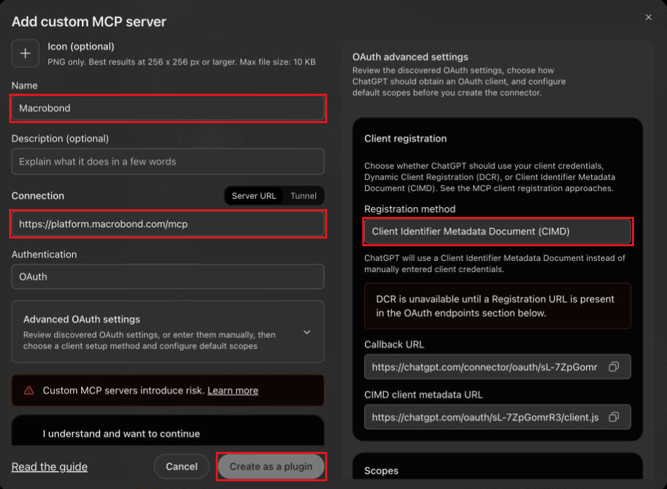

4. Select **I understand and want to continue**, then **Create as a plugin**.
5. Sign in with your Macrobond account when prompted. Start a message with
   **Macrobond** to use it.

The connector belongs to your ChatGPT account, so it is also available in
**Chat**, **Work** and **Codex** in the ChatGPT desktop app.

In a ChatGPT Business workspace, only owners and admins can create a custom MCP
server. If **Add custom MCP server** isn't in the menu, ask your workspace admin
to add Macrobond. See [ChatGPT workspace](#chatgpt-workspace).

### Marketplace

#### ChatGPT desktop app

1. Open **Settings** and select **Plugins**. Select **Add**, then
   **Add a marketplace**.

   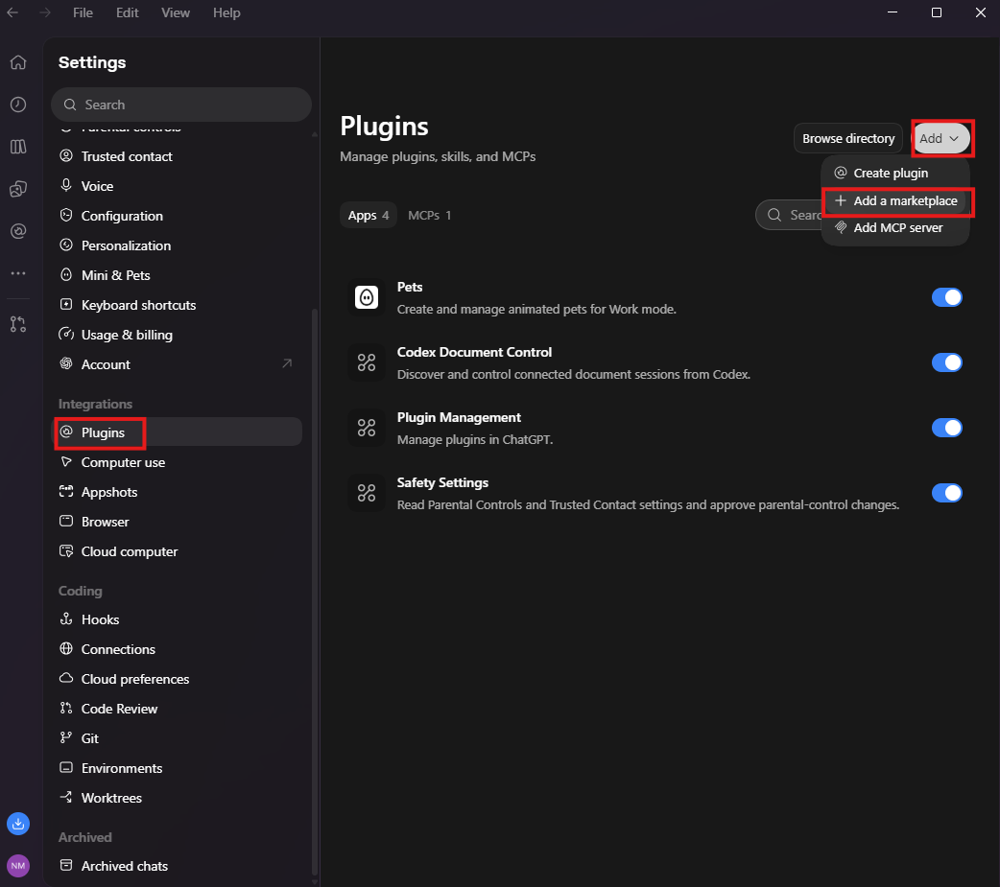

2. Enter `https://github.com/macrobond-platform/macrobond-plugins` as the
   **Source** and select **Add marketplace**.

   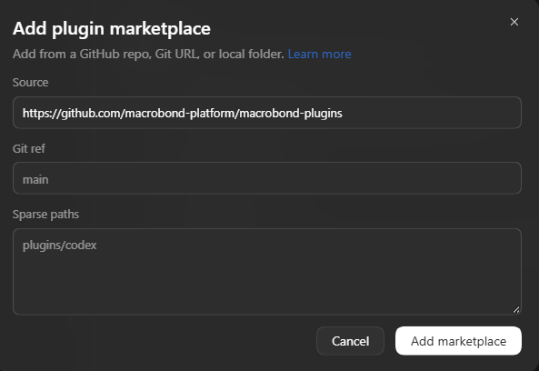

3. Open **Plugins** in the sidebar and select the **Personal** tab. Under
   **Macrobond Plugins**, select **+** next to **Macrobond**.

   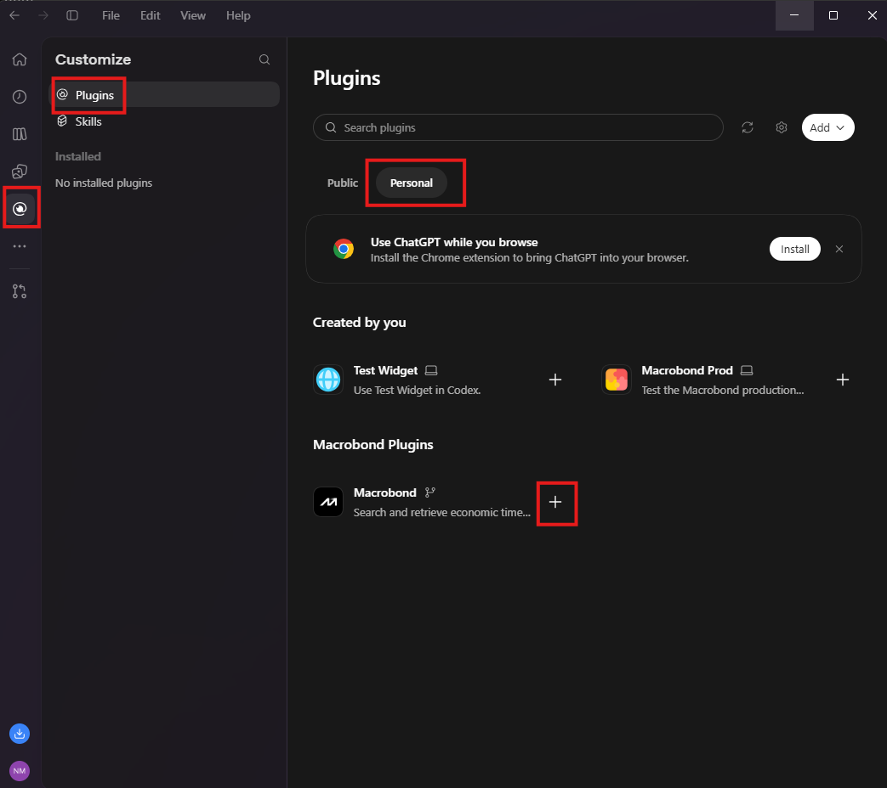

4. Sign in with your Macrobond account when prompted. In **Work** or **Codex**,
   start a message with **Macrobond** to use the plugin.

   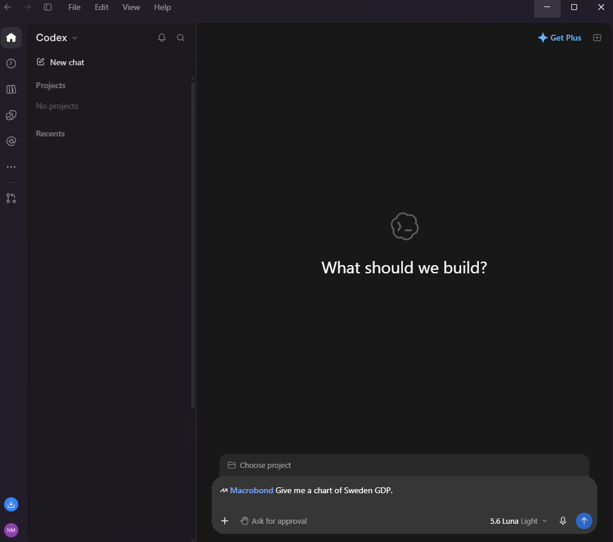

   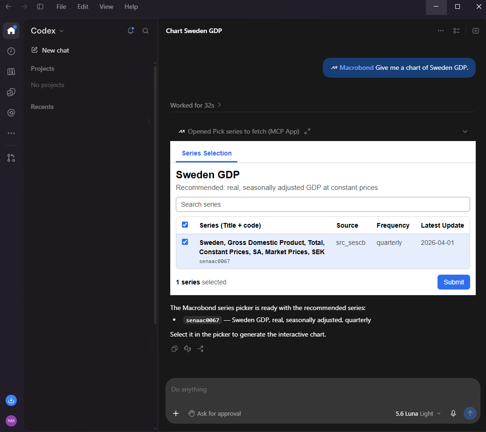

In **Chat**, the plugin is listed but can't reach Macrobond. Use the
[MCP connector](#mcp-connector) there.

### ChatGPT workspace

In a ChatGPT Business workspace, an owner or admin can make Macrobond available
to members in the workspace settings at
[admin.openai.com](https://admin.openai.com):

| Method | Members can use it in |
|---|---|
| [Workspace MCP plugin](#workspace-mcp-plugin) | ChatGPT on the web (**Chat** and **Work**) and the ChatGPT desktop app (**Chat**, **Work** and **Codex**) |
| [Marketplace import](#marketplace-import) | ChatGPT desktop app (**Work** and **Codex**), updated from GitHub |

Each member signs in with their own Macrobond account the first time they use
Macrobond.

#### Workspace MCP plugin

1. In the workspace settings, open **Marketplaces** and select **Add**, then
   **Create MCP plugin**. Turn on developer mode if the form asks for it.

   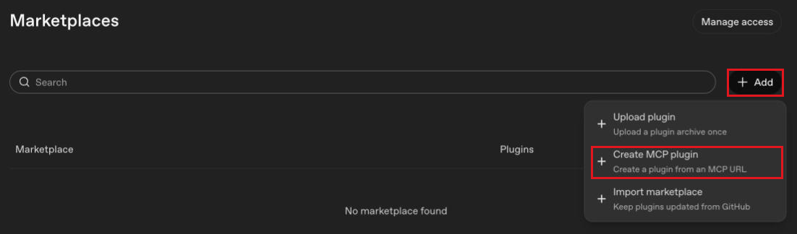

2. Enter **Macrobond** as the name and `https://platform.macrobond.com/mcp` as
   the server URL. Keep **Authentication** set to **OAuth**. Under
   **Advanced authentication settings**, keep the discovered settings:
   **Client Identifier Metadata Document (CIMD)** and all four scopes selected.
3. Select **I understand and want to continue**, then **Create**. Sign in with
   your Macrobond account in the window that opens.
4. Open the new plugin and select **Review app**. Check the tools and
   approvals, complete both risk reviews, then select **Publish**.
5. Under **Availability**, choose **Available** to let members install it, or
   **Installed** to install it for everyone.

Members find Macrobond under the workspace's tab in **Plugins**. They select
**Install plugin**, then **Continue to Macrobond**, and sign in. In the ChatGPT
desktop app, members select **+** next to **Macrobond** if it isn't installed
there yet.

To remove the plugin, open it, set **Enabled** to **Disable** for the entire
workspace, then delete it.

#### Marketplace import

1. In the workspace settings, open **Marketplaces** and select **Add**, then
   **Import marketplace**.

   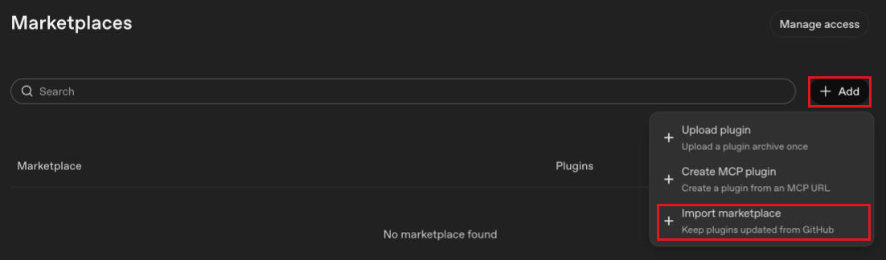

2. Enter `https://github.com/macrobond-platform/macrobond-plugins` as the
   **Source**. Leave the path and branch empty.

   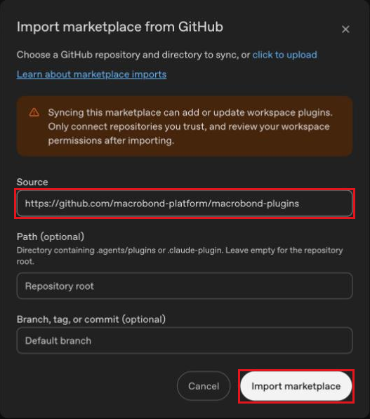

3. Select **Import marketplace** and connect GitHub when prompted. Connecting
   GitHub requires multi-factor authentication on your ChatGPT account.

The import publishes Macrobond to the whole workspace straight away, with no
review step. With **Auto-sync** on, it checks GitHub for updates every day.
Members install it in the ChatGPT desktop app from the workspace's tab in
**Plugins** and sign in with their Macrobond account.

To remove it, open the marketplace's settings and select
**Delete marketplace**. This also deletes the imported plugin.

## Try it

- *"Give me a chart of Sweden GDP."*
- *"Compare US and euro area core inflation over the last ten years."*
- *"Show me a table of German unemployment, monthly, since 2020."*

## How it works

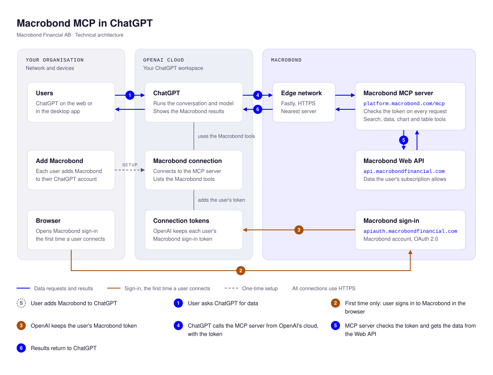

## Changelog

See [`CHANGELOG.md`](CHANGELOG.md).

## License

See [`LICENCE`](LICENCE).
